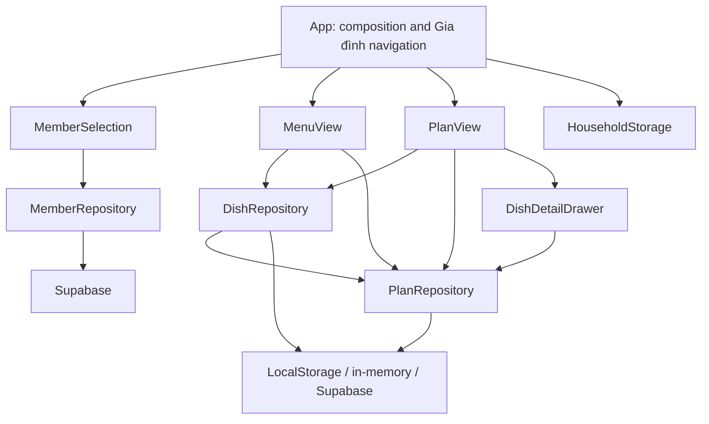

Status: assessment-complete; recommendations-proposed
Date: 2026-10-11

# Whole-codebase design assessment

The project has useful domain functions and real repository seams. Its biggest opportunity is to move guarantees out of callers and into the modules that own them. More folders, smaller React files, or a generic repository would not address the main problems.

This assessment covers the domain, application shell, production screens and dialogs, storage and Supabase adapters, SQL schema and migrations, test design, startup composition, and project decisions. It proposes changes; it does not implement them or assert that the deployed database matches the checked-in SQL.

## Current shape

The graph exposes two kinds of coupling: Menu deletion crosses both repositories, and screens directly own asynchronous resource lifecycles. App also contains the implementation of navigation policy alongside rendering.

| Area | Depth assessment | Direction |
| --- | --- | --- |
| Domain search, dates, retention, Thành viên ordering | Useful behavior behind focused functions | Keep; strengthen only demonstrated invariant gaps |
| DishRepository and PlanRepository | Real adapter variation, but incomplete guarantees | Deepen ownership of mutations and cleanup |
| MemberRepository | Small, meaningful interface; typed failures and confirmed database writes | Keep; verify database behavior separately |
| App navigation | Significant behavior, intertwined with rendering and multiple state variables | Extract one Gia đình session module |
| Screen loading and realtime refresh | Repeated implementation with inconsistent guarantees | Consolidate resource lifecycle behavior |
| Dialogs and async writes | Mixed behavior on pending requests and failures | Standardize save outcomes and dialog mechanics |
| Test suite | Good user-flow coverage; adapter and database fidelity varies | Test guarantees through the owning interface |

## 1. Give Món ăn deletion one owner

**Priority: high.** Evidence: [MenuView.tsx](../../src/components/MenuView.tsx#L123), [dishRepository.ts](../../src/services/dishRepository.ts#L47), [supabaseDishRepository.ts](../../src/services/supabaseDishRepository.ts#L93), [App.tsx](../../src/App.tsx#L179), and [schema.sql](../../supabase/schema.sql#L30).

MenuView runs dish deletion and Kế hoạch cleanup concurrently. Each supplied dish adapter can also invoke that cleanup. Supabase already cascades from Món ăn to Kế hoạch entries and comments. One user action therefore has three cleanup owners in the cloud path. A later cleanup failure can reject an action whose database cascade already committed. Locally, deleting the Món ăn before cleanup completes can leave partial state.

The interface also includes optional `setPlanRepository`, so callers must understand an initialization order before deletion guarantees hold. App repairs that wiring in an effect, even though the factory has already wired it.

**Target:** retain the existing dish operations, but make `deleteDish(code, id)` guarantee that the Món ăn, all its Kế hoạch entries, and their comments are removed on success. The composition root supplies a coherent adapter set once. Remove cleanup from MenuView and remove the mutable repository setter. Supabase deletion relies on the existing database cascade; the local implementation owns its full state update internally.

Do not create an extra module that merely forwards `deleteDish` to two repositories: it would preserve the split ownership. If local persistence needs a shared record containing Menu, Kế hoạch entries, and comments, that record belongs behind the existing interfaces. A versioned record per Gia đình can avoid partial multi-key updates, but requires a tested migration from current keys.

**Deletion test:** removing the deepened module would force callers to relearn cleanup ordering, partial failure, and adapter differences. Those are exactly the facts it should hide.

**Verification:** exercise deletion through the dish interface for every adapter. Assert comments and Kế hoạch entries disappear, another Gia đình stays intact, repeated deletion has a defined result, and persistence failure does not report success. Preserve user confirmation tests. Replace tests that bless screen-level cleanup once interface tests cover the guarantee.

This implements ADR-0003 without changing its behavior.

## 2. Extract Gia đình session policy from App

**Priority: high.** Evidence: [App.tsx](../../src/App.tsx#L75), [storage.ts](../../src/services/storage.ts#L1), and [household-session.test.tsx](../../tests/integration/household-session.test.tsx).

App owns remembered Thành viên verification, join-link precedence, persistence of selection steps, request supersession, saved Gia đình updates, deleted-member notices, and navigation. Transitions repeatedly reset the same independent state variables. `HouseholdNavigationState` has optional fields, permitting `selected` without a Thành viên ID and `choosing_member` without a Mã nhà.

**Target:** one Gia đình session module with a discriminated snapshot and named actions: restore, enter Gia đình, select Thành viên, switch Thành viên, switch Gia đình, forget saved Gia đình, and retry verification. App renders that snapshot. Keep active tab and share-dialog visibility as presentation state unless a specific navigation guarantee requires them inside the module.

The module accepts the existing storage and Thành viên adapters. No new adapter interface is necessary. Internally, a discriminated union requires each state's data; verification carries its target and outcome. Request lifetime and stale-result rejection are implementation facts, rather than caller obligations.

The storage interface should eventually expose navigation and saved Gia đình only. Reading old nickname/code keys remains an internal migration behavior. Legacy nickname setters and the unused `HouseholdSession` shape need not remain part of the current caller interface merely to support migration.

**Verification:** test the new interface with in-memory storage and the existing test Thành viên adapter. Cover same/new Gia đình join links, restored identity by ID, deletion, failed verification without losing remembered state, explicit switching, late responses, and tab independence. Keep a smaller set of App tests proving each snapshot renders the correct screen.

Preserve ADR-0008: running tabs retain their own selection; new tabs/reloads use the latest persisted step; deliberate Gia đình switching always requires choosing a Thành viên. Preserve ADR-0006's database requirement. Do not introduce a local Thành viên fallback.

## 3. Centralize asynchronous resource lifecycle

**Priority: high.** Evidence: [MenuView.tsx](../../src/components/MenuView.tsx#L40), [PlanView.tsx](../../src/components/PlanView.tsx#L77), [MemberSelection.tsx](../../src/components/MemberSelection.tsx#L87), and [DishDetailDrawer.tsx](../../src/components/DishDetailDrawer.tsx#L32).

Menu and Kế hoạch independently implement request versions, current-Gia đình guards, first-load versus refresh failures, subscriptions, and retained data. MemberSelection has its own lifetime guards. The comment drawer lacks equivalent request guards and silently ignores load failures. A late response for a previous Kế hoạch entry can replace the currently displayed comments.

**Target:** a resource lifecycle module, used first by Menu, Kế hoạch, and comments, with a small React interface such as `useResource({ key, load, subscribe })`, returning a discriminated snapshot and `refresh`. Its implementation owns request supersession, cleanup, initial versus refresh failures, and retained data for the same key. Changing Gia đình or Kế hoạch entry clears the previous key's snapshot. `key` must include every identity that determines the data.

Avoid a configurable framework with switches for every screen. Domain-specific querying stays in `load`; the lifecycle module hides concurrency behavior. Do not wrap it in several hooks that merely forward identical arguments. Migrate MemberSelection only if this actually simplifies its mutation/session guards.

PlanView currently calls `pruneOldHistory` on every load, including comment-triggered refreshes, and retrieves all retained/future Kế hoạch entries. Move retention maintenance into a deliberate Kế hoạch initialization step and use the existing date-range query for the visible week. Keep the two-week rule anchored to the base planning date, not to whichever future week the user browses.

**Verification:** controlled promises and fake subscriptions should demonstrate late responses cannot overwrite a new key, same-key refresh failures retain data, first-load failure differs from empty data, unmount stops updates, and retry recovers. Retain existing screen tests for visible errors; replace duplicated lifecycle assertions once the shared module proves them.

## 4. Make mutation outcomes trustworthy across adapters and dialogs

**Priority: high.** Evidence: [DishPickerDrawer.tsx](../../src/components/DishPickerDrawer.tsx#L89), [DishDetailDrawer.tsx](../../src/components/DishDetailDrawer.tsx#L69), [dishRepository.ts](../../src/services/dishRepository.ts#L90), [planRepository.ts](../../src/services/planRepository.ts#L171), and [supabasePlanRepository.ts](../../src/services/supabasePlanRepository.ts#L87).

Normal picker confirmation invokes an asynchronous callback and immediately clears/closes the drawer. Its quick-add path awaits confirmation, while DishModal awaits saves and displays failures. Comment sends silently discard errors. Menu deletion has no pending/error handling. These callers implement different meanings of success.

Local persistence catches write failures but returns successful entities. Supabase history pruning turns a read failure into zero removals and does not inspect the delete result before reporting a count. The Promise-based interfaces therefore do not provide a consistent success guarantee.

Kế hoạch insertion also varies: the in-memory/local domain loop deduplicates repeated IDs within one request, but the Supabase adapter filters only against previously stored IDs. Input `[id, id]` generates duplicate rows. Two devices can both pass the initial existence query; the unique constraint prevents duplicate storage, but one action can fail instead of behaving as an idempotent add.

**Target:** define mutation completion and failure semantics at each owning interface. Resolve after confirmed persistence; reject with a classified error when persistence fails. Await completion before closing dialogs, retain user input on failure, and prevent duplicate submissions. Treat command failure separately from a subsequent refresh failure so a committed write is not repeated because its refresh failed.

Make `addDishesToMeal` deduplicate input and handle existing/concurrent selections atomically in the database. Choose and document its returned result: newly inserted entries or the final selection. Match that meaning in local and in-memory adapters. The existing method is sufficient; callers should not learn check-before-insert ordering.

**Verification:** shared adapter behavior tests for duplicate input, already scheduled selections, failures, and cleanup. A database-backed concurrency test verifies atomic behavior. Dialog tests assert failures keep the drawer and selection available for retry. For comment refreshes, reconcile by comment ID so an arriving realtime response plus a completed send cannot display the same comment twice.

## 5. Test the guarantees at the seams that own them

**Priority: medium; needed before substantial refactoring.** Evidence: [tsconfig.json](../../tsconfig.json#L26), [supabaseMemberRepository.test.ts](../../tests/services/supabaseMemberRepository.test.ts#L121), [supabasePlanRepository.test.ts](../../tests/services/supabasePlanRepository.test.ts#L10), and [memberRepository.ts](../../tests/support/memberRepository.ts).

The existing suite covers important user behavior: Gia đình restoration, switching, Món ăn search and quick-add, dinner-first Kế hoạch, deletion, retention, and errors. Keep that value.

However, the six-Thành viên concurrency test simulates the SQL lock with a JavaScript queue in a fake fetch implementation. It tests error translation and expected outcomes of its own simulation, not the checked-in trigger. Supabase Món ăn/Kế hoạch tests often reconstruct fluent client chains and assert calls, making internal query changes expensive without proving database cascades or constraints. The shared test Thành viên adapter does not enforce capacity or all production validation rules.

Use each existing repository seam for a common behavior suite. Keep targeted SDK wiring tests for mapping, scoping, and cleanup. Test owned PostgreSQL rules against a disposable database using the actual schema/migrations; use multiple database connections for the concurrency case. The hosted SDK and realtime transport remain external dependencies and can use controlled test adapters. An in-memory simulation should not stand in for verification of the SQL implementation.

Include tests in a dedicated TypeScript check. Vitest currently executes them, but the configured compiler excludes them. Retire stale public fields such as App's unused `isOnline` and repository mode flags after checking callers. Do not broaden the production interface to accommodate obsolete test arguments.

Replace lower-level tests only after their guarantees are covered at the new interface. Keep pure domain tests where those functions remain meaningful independently; do not delete them merely because a deeper module also uses them.

## 6. Put Gia đình creation behind a meaningful operation

**Priority: medium; involves a product decision.** Evidence: [household.ts](../../src/domain/household.ts#L13), [OnboardingModal.tsx](../../src/components/OnboardingModal.tsx#L72), and [schema.sql](../../supabase/schema.sql#L7).

Creating a Gia đình currently means generating `BEP-100` through `BEP-999` and storing the code on the device. No production module inserts or reserves a row in `households`. Independent creations can pick the same code and subsequently share the same Menu, Thành viên, and Kế hoạch partition. The table currently offers no protection because the creation path never uses it.

Decide whether creation guarantees a new Gia đình or merely offers a random Mã nhà. If it guarantees a new Gia đình, put code reservation and collision retry inside a creation module; its caller receives a confirmed Mã nhà. Joining remains a separate operation with the agreed existing semantics. Choose a larger code space while preserving manually entered and saved codes.

This decision can retain zero-account access. Adding personal authentication would reopen ADR-0001/0006/0008 and should not be smuggled into this refactor. The current permissive SQL policies and client filters are not access control, as ADR-0008 already explains.

The database also checks referenced row existence but not that an entry/comment's Gia đình matches its referenced Món ăn/Kế hoạch entry. Add same-Gia đình integrity guarantees behind the persistence seam if strengthening the data model; they are distinct from authentication.

## Smaller opportunities and things to keep

- **Dialog mechanics:** MemberDialog already hides focus trapping, Escape handling, focus restoration, and busy dismissal. Other dialogs independently implement only parts of this behavior. Extract the proven mechanics into one dialog module with title, content, and dismissal policy; keep presentation differences local. There are multiple real callers, so this extraction earns leverage.
- **Realtime recovery:** SupabaseMemberRepository handles subscribed status, foreground/online refreshes, polling, and cleanup; Món ăn/Kế hoạch adapters lack those recovery paths. Share transport recovery where guarantees match, and test reconnection followed by refetch. Choose polling according to actual freshness needs rather than automatically copying a 15-second interval everywhere.
- **Realtime deletion:** current Supabase documentation says filtered DELETE events require full replica identity; the checked-in schema enables that setting for all four data tables. Do not infer a broken delete subscription solely from the filters. Deployment and actual transport behavior still need verification. Source: [Supabase Postgres Changes documentation](https://supabase.com/docs/guides/realtime/postgres-changes#delete-events), checked 2026-10-11.
- **Composition:** select default adapters at startup once and inject coherent dependencies. Screens should not silently manufacture an alternative default repository when a caller omits one. The current factory is useful composition; do not add another pass-through abstraction over it.
- **Domain functions:** keep Vietnamese search normalization, Thành viên ordering at sub-millisecond precision, and explicit date/retention functions. Small functions can have depth. Their size alone is not a reason to merge or wrap them.
- **Prototype:** the Thành viên prototype is intentionally loaded only in development. Keep that isolation; promoting it into a generalized production module would introduce accidental coupling.
- **Deployment locality:** the setup guide still describes the removed online badge and omits `20261011_member_limit.sql` from existing-project migration steps. Update instructions alongside the relevant implementation so checked-in guarantees can actually reach older deployments.

## Suggested sequence

1. Specify repository success, deletion, and idempotent-add guarantees; establish adapter behavior tests and test type checking.
2. Deepen deletion ownership and fix mutation error/pending handling. This reduces concrete partial-success and lost-retry risks.
3. Extract Gia đình session policy with ADR-0008 behavior preserved. App becomes composition and rendering.
4. Consolidate loading lifecycles, starting with Menu/Kế hoạch/comments; separate retention maintenance from refresh and scope visible-week reads.
5. Add actual database constraint/concurrency verification, align test adapters, and consolidate realtime recovery and dialog mechanics where callers share guarantees.
6. Resolve Gia đình creation semantics before implementing reservation/code-space changes.

These are incremental changes. Avoid a single broad rewrite, a universal CRUD repository, or one enormous cooking module. Depth comes from concentrating guarantees that callers currently have to know.

## Verification performed

- `npm test -- --reporter=dot`: **26 files, 265 tests passed**.
- `npm run typecheck`: **passed** under the existing configuration.
- Read-only compiler probe including `tests` with the existing options: **36 diagnostics**, including unused declarations. Excluding unused declarations and unused `ts-expect-error` directives leaves **22 diagnostics**. Examples include obsolete `AppHeader.isOnline` arguments, unsupported `getByRole` options, and a Món ăn fixture missing `createdAt`.
- The test run emitted React `act` warnings and multiple Supabase client warnings; passing results should not be described as a warning-free run.
- No deployed SQL, real concurrent database requests, or live multi-device realtime behavior was exercised. Database and transport observations are source-level findings unless explicitly stated otherwise.
- Application source and configuration were not changed by this assessment.
